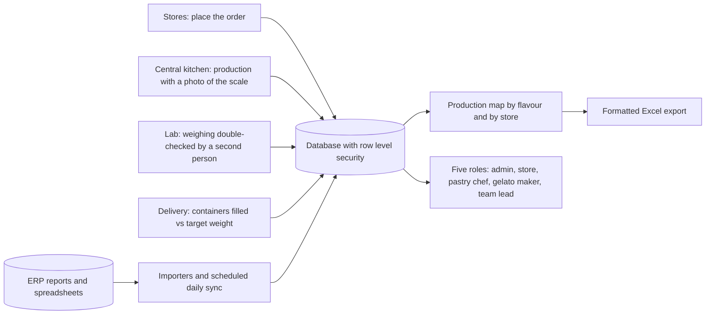

# Gelato production and stock control system (IRIS)

> **Operations & control** · In operation and expanding
>
> Parte do meu portfólio / Part of my portfolio: [portfolio-automacoes](https://github.com/Rapunzelmina/portfolio-automacoes) · [Português](#português) · [English](#english)

## Como funciona / How it works

## Português

### Sistema de controle de produção e estoque de gelato (IRIS)

**Área:** Operação e controle · **Status:** Em operação e em expansão

#### Problema

O pedido das lojas à cozinha central, a produção, a pesagem do gelato e o envase do delivery eram acompanhados em planilhas separadas. Não havia registro de quem pesou o quê, nem comparação entre o que foi produzido, o que saiu e o que foi perdido.

#### Solução

Um sistema web instalável, com cinco perfis de acesso (administrador, loja, confeiteiro, gelateiro e líder). **Pedido:** a loja recebe uma sugestão calculada de quantas BAGs pedir e registra o que foi enviado, com motivo quando muda a quantidade. **Produção:** a cozinha registra quantidade, peso e foto da balança. **Laboratório do gelato:** pesagem de cubas com foto, conferência por uma segunda pessoa (quem registra não confere a própria), tolerâncias, tara, perda de prova e descarte com motivo, resultando num mapa de produção por sabor e por loja, com ranking e ocorrências para o controle. O mapa do mês também é exportado para um Excel formatado, com painel e gráficos, mapa de calor por sabor, ranking semanal e uma aba por dia com as contas em fórmulas. **Delivery:** compara o gelato usado com os potes enchidos e a gramatura de cada tamanho. **Equipe e turnos:** acesso por PIN, com bloqueio após tentativas erradas. Também há cardápio do mês, consulta de compras e estoque, e importadores que trazem relatórios do ERP e planilhas para o banco, com sincronização diária agendada.

#### Tecnologias

- JavaScript puro (módulos ES) e PWA, publicado na Vercel
- Supabase: PostgreSQL, Auth, Storage, funções e triggers, row level security (11 migrações)
- Python: importadores de relatórios e planilhas, sincronização diária agendada
- Playwright: robô que baixa relatórios do ERP
- Protótipo inicial em FastAPI + SQLite

#### Resultado

Em poucas semanas o escopo saiu de pedido e produção de um único produto para um sistema de controle da operação, com mais de 11 mil linhas de código e 11 migrações de banco, e a sincronização diária já roda agendada. Custo de receita, baixa automática de insumos e reposição automática seguem em estudo.

#### O que eu fiz

Entendi a rotina da cozinha e das lojas (pedido, produção, pesagem do gelato e envase do delivery) e a transformei em regras e telas. Desenhei os perfis e as permissões dentro do banco, criei os importadores que trazem os relatórios do ERP e das planilhas e separei o que já funciona do que ainda está em estudo.

## English

### Gelato production and stock control system (IRIS)

**Area:** Operations & control · **Status:** In operation and expanding

#### Problem

Store orders to the central kitchen, production, gelato weighing and delivery container filling were tracked in separate spreadsheets. There was no record of who weighed what, nor a comparison between what was produced, what left and what was lost.

#### Solution

A web app you can install, with five access roles (administrator, store, pastry chef, gelato maker and team lead). **Ordering:** each store gets a calculated suggestion of how many BAGs to order and records what was sent, with a reason when the quantity changes. **Production:** the kitchen records quantity, weight and a photo of the scale. **Gelato lab:** weighing of tubs with a photo, double-checking by a second person (whoever records a weighing does not verify their own), tolerances, tare, tasting loss and waste with a reason, producing a production map by flavour and by store, with a ranking and incidents for the control team. The month's map is also exported to a formatted Excel file, with a dashboard and charts, a heat map by flavour, a weekly ranking and one sheet per day with the calculations as formulas. **Delivery:** compares the gelato used with the containers filled and the target weight of each size. **Team and shifts:** PIN-based access with lockout after wrong attempts. There is also a monthly menu, a purchasing and stock view, and importers that bring ERP reports and spreadsheets into the database, with a scheduled daily sync.

#### Tech

- JavaScript puro (módulos ES) e PWA, publicado na Vercel
- Supabase: PostgreSQL, Auth, Storage, funções e triggers, row level security (11 migrações)
- Python: importadores de relatórios e planilhas, sincronização diária agendada
- Playwright: robô que baixa relatórios do ERP
- Protótipo inicial em FastAPI + SQLite

#### Result

In a few weeks the scope went from ordering and production of a single product to an operations control system, with over 11,000 lines of code and 11 database migrations, and the daily sync already runs on a schedule. Recipe costing, automatic ingredient deduction and automatic replenishment are still under study.

#### What I did

I learned the routine of the kitchen and the stores (ordering, production, gelato weighing and delivery filling) and turned it into rules and screens. I designed the roles and permissions inside the database, built the importers that bring in ERP reports and spreadsheets, and kept what already works separate from what is still being studied.

---

*Código-fonte privado: contém integrações e informações do ambiente corporativo. Este repositório apresenta o projeto como um *case* técnico de portfólio e não contém código, credenciais, dados de clientes, nomes de lojas ou fornecedores, nem URLs ou números internos.*

*Source code is private: it contains integrations and information from the corporate environment. This repository presents the project as a technical portfolio case study and contains no code, credentials, customer data, store or supplier names, or internal URLs or figures.*
